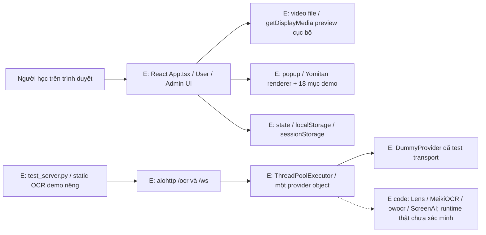
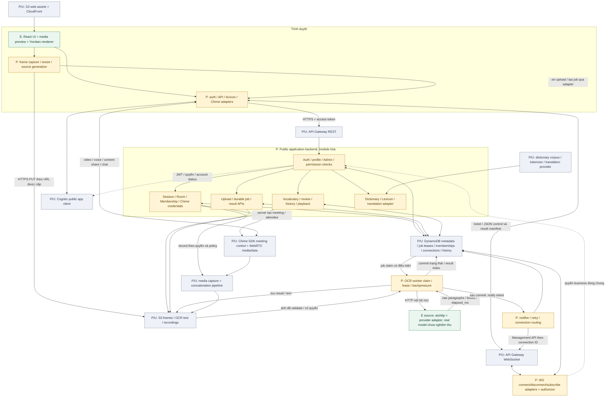

# CT-01 — Kiến trúc tích hợp đề xuất

**DRAFT, 11/11/2026 — chưa được ba thành viên xác nhận.** Áp dụng phương án khuyến nghị trong [D01–D14](../contracts/decisions.md), đặc biệt D05 upload HTTP/S3. Không mô tả hạ tầng đã triển khai và không thay thế OpenAPI/AsyncAPI của CT-02.

Nguồn hiện trạng: [audit code và dòng bằng chứng](G0-CURRENT-STATE.md). Giữ UI/hover/sáng tối, media preview và Yomitan renderer hiện có; thêm adapter ở các task được giao sau.

## 1. Sơ đồ hiện trạng đã thấy trong code

**Không có đường React → OCR trong source hiện tại.** Bằng chứng: [hook nguồn](../src/hooks/useRoomMedia.ts#L20), [banner preview](../src/App.tsx#L747), [OCR routes](../meikipop-ocr-server/src/meikipop_ocr_server/server.py#L231). Static demo OCR và React là hai giao diện khác nhau; lỗi field của static demo không có nghĩa React đã tích hợp rồi bị lỗi.

## 2. Sơ đồ đích đề xuất

Ký hiệu: **E** = đã có source, phạm vi cụ thể ở audit; **P** = cần triển khai/tích hợp; **U** = tài nguyên/deployment ngoài workspace chưa truy cập. Mũi tên trong sơ đồ đích là luồng **dự kiến**, kể cả khi node đã có source. Node `P/U` là dịch vụ dự kiến dùng nhưng account/resource thật chưa xác minh.

Màu xanh chỉ source có sẵn, không đồng nghĩa chức năng đầu cuối đạt. Chưa có service mới trong sơ đồ được tạo bởi lượt audit.

### Cách đóng gói để vừa sức nhóm

- **Một app backend module hóa**, một public API; giữ backend hiện có nếu Hoàng Bảo cung cấp được repo, nếu bắt đầu mới dùng stack đã chốt ở D07. Room, profile, vocabulary, Admin và lexicon không cần thành microservices riêng ngay.
- **Worker OCR tách process/lifecycle** khỏi request app; giữ internal OCR provider interface hiện tại. Job lưu bền vững, không dùng thread pool queue hoặc coroutine trong RAM làm queue hệ thống. DDB conditional claim/lease + backoff là đề xuất v1; không thêm SQS mặc định trong CT-01.
- **Gateway REST + WS là hai integration khác nhau.** REST chuyển HTTP vào app; Gateway WS cần adapters `$connect/$disconnect/subscribe` và connection store, callback bằng Management API. Đề xuất Lambda adapters mỏng cho WS/authorizer, logic quyền thống nhất với app; không proxy nguyên socket tới aiohttp `/ws`.
- Route từ Gateway/Lambda đến app/worker và loại private load balancer/VPC integration là việc IF-01/IF-03 cần chứng minh trên region/account đã chọn. Sơ đồ chưa phải một network topology có thể deploy; không tự khẳng định private routing đã hoạt động.
- S3 giữ bytes/JSON/video; DDB giữ query metadata/indices. Bảng thực thể không đồng nghĩa mỗi thực thể cần một physical table. Hoàng Bảo thiết kế query/storage, Bảo Anh dùng cùng writer interface, Đức không dựng S3 key ở browser.
- Local đề xuất frontend 8443, app API 8081, OCR nội bộ 8080; Vite/reverse proxy cùng origin và local upload adapter. Các đường nối/proxy/upload adapter **chưa có**; port là quy ước đề xuất, không là bằng chứng service đang nghe.
- Mock và real dùng cùng contract tương lai; real không âm thầm fallback fixture. Cấu hình `VITE_DATA_MODE` chưa có trong implementation hiện tại, là việc tích hợp phải thêm sau khi được giao.

## 3. Solo: nguồn → frame → OCR → tra/lưu từ

1. **Đăng nhập thật (P):** auth adapter thay timer/local flag, lấy `/me` theo danh tính kiểm chứng. Solo tạo session có owner; không tạo room/Chime meeting để giả lập solo. Flow/token storage chờ D14.
2. **Chọn nguồn (E + P):** tái sử dụng `useRoomMedia` để mở file/share cục bộ. Theo D08 draft, client tạo UUID đề xuất cho source_id/frame_id, backend đăng ký/xác nhận source và cấp source_index/current_source theo quyền, không suy thứ tự từ UUID. Nhóm phải xác nhận lựa chọn này trước CT-02; request/retry schema được chi tiết hóa sau gate. Mỗi đổi nguồn một source ID; generation nội bộ vẫn dùng để hủy kết quả cũ.
3. **Capture (P):** chỉ khi video sẵn sàng và user có quyền. Lấy frame, resize giữ tỷ lệ/nén/kiểm byte/pixel theo config hiệu lực. `media_time_ms` video từ currentTime; screen từ elapsed monotonic. Không ghi camera/audio vào OCR.
4. **Upload/job (P):** API kiểm owner/source/quota → cấp upload_id + URL/headers tạm → browser PUT ảnh → POST job với upload/frame IDs + idempotency key. Backend kiểm object thuộc đúng upload/session và byte/pixel thực. Không nhận một URL tùy ý từ client để server tải về.
5. **Nhận dạng (E provider source + P worker):** worker claim job có lease, đọc frame, gọi internal `/ocr`, phân biệt no-text với fail/timeout/busy. Provider hiện chưa có readiness/concurrency/error contract hoàn chỉnh; các sửa chữa phải được Bảo Anh giao rõ phạm vi ở task sau.
6. **Lưu rồi thông báo (P):** lưu raw/public result/text, commit job/result index, sau đó notify. Nếu crash sau commit trước push, notifier retry/reconciliation hoặc client polling vẫn đọc được; không gọi đây là exactly-once delivery. Completion và client apply phải dedupe.
7. **Hiển thị (P nối E):** WS manifest hoặc polling GET trỏ cùng result_id. Browser kiểm session/source/frame/seq, bỏ result cũ, vẽ box trên vùng video thật sau object-fit contain. Empty/error/expired/retry hiển thị đúng, không giữ câu sample trên nguồn mới.
8. **Tra từ (P nối E):** app lexicon xử lý OCR text + token/ngữ cảnh, trả lemma/sense/POS/reading/nghĩa có nguồn và code point offsets. Adapter map vào Yomitan renderer hiện tại; cache/debounce/hủy lookup cũ, có unknown/not_found/error. Không coi `words[]` OCR là token ngữ pháp.
9. **Lưu/ôn/lịch sử (P nối E):** POST vocabulary theo owner/scope/entry/sense, occurrence theo source/result/media_time. Ôn cập nhật review_state/version, reload còn dữ liệu. History query từ chỉ mục thật; chỉ bật playback khi recording ready và URL có quyền/hạn dùng.
10. **Rời/đổi nguồn (E + P):** cleanup track/object URL đã có; bổ sung dừng timer/capture/pending request, kết thúc/đổi source phía server. Result muộn vẫn có thể lưu vào lịch sử hợp lệ nhưng không vẽ lên nguồn mới.

## 4. Group: phòng → thành viên → content share → OCR đồng bộ

1. **Host tạo phòng (P):** app xác thực user, tạo room/shared_session/membership host và mã phòng có unique constraint. Mã phòng để mời khác room_id và không phải credential cấp mọi quyền.
2. **Member join (P nối E dialog):** nhập code, backend kiểm room còn mở/quota/account, tạo membership idempotent; cấp meeting/attendee credentials theo quyền. Không đưa JoinToken vào room list, history hoặc Admin overview.
3. **Chia sẻ nội dung (P nối E hook):** host/solo có khả năng nguồn, member chỉ xem. Chime client gửi content share/voice/video trực tiếp theo media path; nút mic/camera hiện chỉ state phải được nối SDK. File video muốn chia sẻ cũng cần media path được kiểm chứng, không chỉ object URL trên máy host.
4. **Một producer OCR (P):** chỉ host của shared_session chụp và gửi frame cho nguồn chung. Backend chặn member tự gửi upload/job; không xử lý lại cùng frame cho từng viewer. Mục tiêu tải tính theo nguồn, không nhân số người trong phòng.
5. **Kết quả dùng chung (P):** worker chạy một job, commit result; notifier query membership/connection đang hợp lệ và phát manifest đến đúng phòng. Source/session/frame/seq đủ để bỏ event cũ/trùng và resync qua GET khi reconnect.
6. **Đồng bộ có giới hạn (P):** WebRTC video và WS OCR có độ trễ độc lập. Box gắn frame/source timestamp, không đảm bảo khớp từng pixel của mọi video frame ở mọi member. Chốt budget độ lệch; nếu không khớp thì hiện transcript/snapshot đúng frame thay vì đặt box cũ lên hình mới. Đây là tiêu chí cần test, không hứa đồng bộ tuyệt đối.
7. **Chat/từ chung (P nối E):** chat theo D06, sender lấy identity được cấp; vocabulary chung qua API/quyền D09, riêng và chung tách scope. Chime data messages không thay durable vocabulary store hoặc audit.
8. **Leave/close/revoke (P):** member leave chỉ rời membership/attendee của mình; host close hoặc mất kết nối quá grace theo policy mới đóng room/meeting. UI hiện chưa phân biệt backend leave/close. Khóa tài khoản/maintenance/close có action pending/failed và audit theo draft D15/D16; không chỉ giảm member_count local về 0.
9. **Lưu/playback (P):** consent/policy cho recording, Chime capture/concatenate, timeline mapping và index từng người được phép xem. Group session lưu chung OCR result, user history chỉ là tham chiếu có quyền; không nhân bản video cho mỗi member.

## 5. Invariants bắt buộc khi viết contract sau review

| Ranh giới | Điều cần giữ |
| --- | --- |
| Identity | User/Admin là role hệ thống; host/member theo room; backend luôn kiểm account/membership/ownership. Dev role không cấp quyền thật |
| Raw/public OCR | Giữ raw `paragraphs/full_text/box/words/is_vertical/elapsed_ms`; public wrapper thêm IDs/timeline/language/provider/image dimensions. Không biến field sai của demo thành chuẩn |
| Job/upload | Object gắn upload/user/session/source; durable state và lease; retry cùng key/body không tạo job mới; không có URL tùy ý từ browser |
| Timing | UTC cho audit; media time theo source; source mới hủy kết quả view cũ; `elapsed_ms` không phải end-to-end latency |
| WS | Event nhỏ; không ảnh binary; sequence/dedup/resync; vé ngắn hạn; route và push kiểm quyền, không dựa mã phòng hoặc số socket |
| Media | Chime video/voice/content share độc lập OCR; solo không bắt buộc Chime; recording là pipeline riêng |
| Dictionary | Renderer không tạo nghĩa; POS/reading/lemma/senses/provenance từ service; unknown rõ, không bịa dictionary entry |
| Storage | Personal/shared scope và membership/history permissions; `word_id`/sense bền vững; playback URL ký có hạn; null không biến thành 0 |
| Admin | Reason/version/idempotency/audit; desired khác effective config; chỉ báo applied sau worker xác nhận; reset demo không có API xóa thật |
| Handover | Mỗi AI cùng version/SHA/fixtures sau freeze, module owner rõ; không tự đổi endpoint/enum/auth/offset/đơn vị ở nhánh riêng |

## 6. Thứ tự tích hợp đề xuất sau khi nhóm xác nhận

1. Xác nhận repo backend/account/scope/token/transport/IDs; ghi lựa chọn từng Dxx, gồm D15/D16 đang mở. Hoàn tất review CT-01 trước CT-02.
2. CT-02/CT-03/CT-04: schema/fixtures/error/ports/runtime/ownership và mock từ cùng schema; auth + `/me` là nền cho User/Admin thật. Không dùng fixture để nghiệm thu real mode.
3. Solo đầu cuối nhỏ: source → một frame → durable job → raw OCR thật → result → popup thật → lưu từ → reload. Giữ các component hiện hữu.
4. Room hai người và hai phòng; Chime/presence/chat, chỉ một nguồn OCR/room, test cross-room/reconnect/leave/close/revoke.
5. History/review/recording/playback, Admin read/actions/config thật, benchmark/concurrency và cloud deployment theo phạm vi đã được giao.

Đức chủ frontend và tích hợp; Hoàng Bảo chủ app API/auth/room/storage/infra; Bảo Anh chủ provider/worker/lexicon/log theo phân công bổ sung cần review. Không đổi server hoặc giao diện chỉ vì sơ đồ này đã được viết. **Kiến trúc trên vẫn là draft; CT-02 chưa bắt đầu.**
