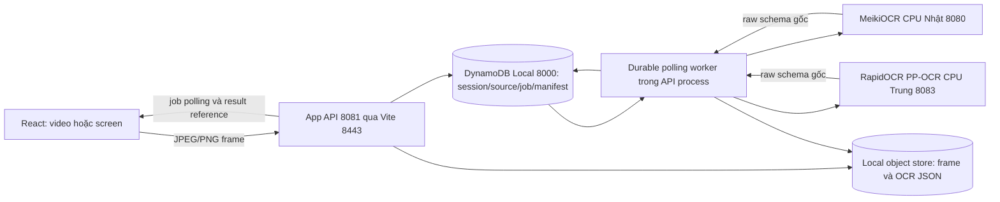

# Nhóm 5 — OCR thật, frame pipeline và tích hợp giao diện

Ngày: 13/11/2026. Owner: Nguyễn Tài Đức. Trạng thái: **LOCAL_IMPLEMENTED / READY_FOR_MANUAL_REVIEW**, chưa nghiệm thu deployment hoặc UI browser tự động. Tiếp nối [API nhóm 4](GROUP-04-APPLICATION-API.md), ứng với OC-01…OC-06/G2 của kế hoạch gốc; không phải G5 lưu trữ trong cách đánh số cũ.

Đã có nhận dạng thật bằng CPU local cho **Nhật và Trung**, qua application API/worker/database/object store. Không dùng AWS/Docker, không gửi video/ảnh người học tới Google Lens hay API OCR bên ngoài. Chỉ tải package/model ở bước setup; runtime Nhật chạy HF_HUB_OFFLINE=1, Trung dùng model có sẵn trong wheel. Không coi model test là kết quả tra từ/dịch/ASR.

Public/raw contracts giữ nguyên `0.1.0-draft.1`, DRAFT. Các lựa chọn provider/port dưới là cấu hình triển khai local, không tự approve D11/D12 hoặc chọn region/cloud infrastructure.

## Kiến trúc đang chạy — local draft



OCR là đọc chữ trong ảnh. Cách đọc, POS, lemma, nghĩa và dịch câu cần lexicon/translation ở nhóm sau. Nguồn thật không dùng popup/catalog mẫu để giả làm dữ liệu từ điển mới.

## Luồng Solo

1. Người học đăng nhập, tạo/tiếp tục phiên, chọn video hoặc chia sẻ màn hình. Video ở trình duyệt, không upload nguyên file.
2. Bấm **Nhận dạng chữ**. FE đăng ký source UUID + kích thước/duration, server cấp source_index và session version mới. Chưa bấm thì chỉ preview, không chụp/gửi frame.
3. Canvas chụp nội dung video thực, resize giữ tỷ lệ với cạnh dài tối đa 1600, tối đa 4 triệu pixel và 1 MiB/frame. JPEG giảm quality nếu cần; từ chối canvas/video không đọc được, không thay bằng ảnh mẫu.
4. Tạo upload metadata → PUT bytes theo capability ngắn hạn → tạo job. Frame có session_id/source_id/frame_id/frame_index/media_time_ms/captured_at xuyên suốt. Một client chỉ có một frame đang xử lý; không OCR mọi video frame.
5. Worker nhận job từ DB, claim bằng lease/fencing, gọi HTTP `/ocr` của provider tương ứng session.language. Chỉ nhận schema raw hợp lệ và tọa độ normalized hợp lệ; lỗi provider tách khỏi paragraphs rỗng.
6. Ghi immutable PublicResult JSON và object reference, result manifest, job succeeded, seq/version session trong transaction. FE poll job rồi lấy `/results/{result_id}`; không nhận binary frame qua Gateway WS.
7. Overlay bù letterbox/pillarbox theo `object-fit: contain`; panel có chữ thật và mốc video. Chữ dọc giữ is_vertical. Overlay quá xa mốc đang xem được ẩn, không gắn chữ cũ lên scene khác.
8. Kết thúc phiên → History → chi tiết buổi học để đọc OCR đã lưu. DB giữ metadata/index; file OCR JSON nằm trong object store. Chưa có video playback/recording.

## Giới hạn, lỗi và phục hồi

| Tình huống | Hành vi |
| --- | --- |
| No text | Job succeeded, result_id thật, paragraphs=[]; không đổi thành provider error |
| Ảnh hỏng/khác metadata/type/size | 422/415/413 phù hợp; không gọi model |
| Upload capability | HMAC header, thời hạn 120 giây, scope upload/source/session; không nhét access token vào URL hoặc lưu URL trong idempotency |
| Queue | Một job active mỗi session, bound bằng DB slot/CAS; 429 nếu bận, FE bỏ frame và chờ thay vì tích queue vô hạn |
| Job | Deadline 60 giây, lease 30 giây, tối đa 3 claims khi phục hồi; server/provider timeout 20 giây, poll có giới hạn |
| Dừng/khởi động lại worker | Job queued và processing nằm trong DB; worker mới nhận queued hoặc lease hết hạn; worker cũ không commit được sau đổi lease |
| Source change/end | Không nhận frame nguồn cũ; worker kiểm lại trước commit và fail STALE_SOURCE. FE abort request/timer và bỏ result không khớp source/frame/job |
| Duplicate | Idempotency + unique source/frame job; cùng frame không sinh kết quả/provider call trùng trong luồng retry đã kiểm |
| Out-of-order | frame_index tăng trong từng source; frame cũ trả 409 reason=out_of_order_frame. Seek video vẫn dùng index mới, media_time_ms có thể lùi |
| Frame/source resize | Dừng OCR và yêu cầu bấm lại để đăng ký source mới; không áp box theo kích thước cũ. Screen timeline không reset khi chỉ stop/start cùng source |
| Mất mạng/provider busy/timeout | Hiện lỗi hoặc backoff có giới hạn; không fallback dummy/mock. Native inference timeout vẫn giữ slot đến khi thread kết thúc, không chồng scan trên shared provider |
| Rời phòng/logout | Dừng capture, timer, request và media. Frame đã gửi có thể xử lý xong; không hứa hủy được native inference đang chạy |

Expiry upload là **hạn quyền truy cập**, không phải bảo đảm file ảnh đã được xóa khỏi đĩa. Cleanup/retention raw frames, orphan objects và TTL vật lý vẫn ở bước lưu trữ/production sau. Chưa có distributed queue, AWS callback, Chime hoặc load test nhiều máy. Các giới hạn local là tham số triển khai, chưa là SLA D12 được duyệt.

## Provider và môi trường

| Phần | Cấu hình đã kiểm |
| --- | --- |
| Backend | Python 3.12/aiohttp; thêm duy nhất Pillow 13.0.0 vào venv/lock backend để decode/validate ảnh |
| Nhật | MeikiOCR 0.3.5 + ONNX Runtime CPU; venv riêng, 30 runtime packages trong requirements-local.lock; 3 model HF pin revision + SHA-256 |
| Trung | RapidOCR ONNX Runtime 1.4.4/PP-OCRv4; venv riêng .venv-zh, 23 runtime packages trong requirements-zh.lock; 3 model bundled có SHA-256 |
| Lý do tách venv | MeikiOCR dùng opencv-python-headless, RapidOCR dùng opencv-python; tránh ghi đè cùng namespace cv2 |
| Frontend | Giữ dependency/lockfile và style cũ; thêm capture hook, API methods, geometry, overlay/panel/history. Không redesign trang |

[MeikiOCR upstream](https://github.com/rtr46/meikiocr), [RapidOCR upstream](https://github.com/RapidAI/RapidOCR), [wheel RapidOCR đã pin](https://pypi.org/project/rapidocr-onnxruntime/1.4.4/). Kiểm tra lại điều kiện sử dụng model/package khi đóng gói/phát hành; task này không đưa binary model/font vào Git hoặc phát hành sản phẩm.

Đã sửa provider server trong phạm vi task OCR mới: shared-provider admission/cleanup/timeout, byte/pixel limits, HTTP/WS errors an toàn, Origin WS/HTTP, readiness theo initialization, static demo đọc full_text/box/is_vertical. MeikiOCR đổi input RGB thành BGR đúng API library, fail startup khi thiếu model và chặn box ra ngoài ảnh. **Raw success/error field shape không đổi**. Direct `/ws` vẫn là giao thức nội bộ riêng, không trở thành AWS API Gateway WS.

## Lệnh chạy

Dependencies/model đã cài trên workspace hiện tại. Checkout mới, sau setup backend Python 3.12:

```bash
application-backend/.venv/bin/python -m pip install -r application-backend/requirements.lock
./scripts/setup-local-ocr
./scripts/setup-local-ocr-zh
```

Các setup scripts không xóa venv hiện có, chỉ cài pin tương ứng và kiểm model; không cài package toàn máy. Nhật tải model HF ở revision đã khóa. Chưa chứng nhận một OS/architecture mới từ kết quả macOS arm64 này.

Chạy từng service trong terminal riêng, không start bản thứ hai trên cổng đang dùng:

```bash
./scripts/dev-db         # 127.0.0.1:8000
./scripts/dev-ocr        # 127.0.0.1:8080, Nhật
./scripts/dev-ocr-zh     # 127.0.0.1:8083, Trung
./scripts/dev-local-api  # 127.0.0.1:8081, 26 public handlers + worker
pnpm dev --host 127.0.0.1 --port 8443
```

Mở http://127.0.0.1:8443. App flags: OCR_ENABLED=0/1; OCR_SERVICE_URL=loopback origin; OCR_CHINESE_SERVICE_URL optional. Wrapper dev-local-api bật OCR và mặc định Chinese endpoint 8083; `OCR_ENABLED=0 ./scripts/dev-local-api` vẫn chạy API metadata khi không cần model. Không có mock/real fallback.

## Kiểm thử đã chạy

```bash
./scripts/test-api
./scripts/test-real-ocr
node node_modules/typescript/bin/tsc --noEmit --ignoreDeprecations 5.0
node node_modules/vite/bin/vite.js build
```

Report [group04-05-results.json](group04-05-results.json) tách rõ:

- HTTP/DB/API/worker tests: producer OCR synthetic có nhãn fixture.synthetic, chỉ cho APP_ENV=test. Không báo những tests này là model accuracy.
- Production TypeScript OCR client: 8 checks qua HTTP thật + DynamoDB, gồm upload/job/polling/reference/duplicate/stale-source/end latest version. Geometry: 7 checks cho letterbox/pillarbox/resize/invalid dimensions. Đây không phải browser DOM test.
- Model acceptance thật: **5/5** inputs tự render (Nhật ngang/dọc, Trung ngang/dọc, no-text); chạy hai model CPU thật xuyên API/worker/DB, không hardcode output model. So sánh exact text với input, raw/public schema và result references đều kiểm. Đây là smoke nhỏ, không suy ra độ chính xác tổng quát trên phim/game/nhỏ/mờ.
- Input/output ở `.local-data/ocr-acceptance/`; test dùng bảng `lingualive-test-real-ocr-*` rồi xóa, không seed DB ứng dụng. Log raw local không commit. Report JSON bàn giao không chứa credential/capability.

Để tạo lại ảnh kiểm thử cần font Nhật/Trung trên máy (mặc định font hệ thống macOS, không copy font vào repo):

```bash
application-backend/.venv/bin/python tools/integration/prepare_ocr_fixtures.py
./scripts/test-real-ocr
meikipop-ocr-server/.venv/bin/python tools/integration/make_ocr_demo.py
```

## Các ca bạn thao tác trên web — MANUAL_PENDING

Danh sách đầy đủ file tạo/sửa nằm ở `file_changes` trong [report chung](group04-05-results.json). Các thư mục có tác dụng:

| Vị trí | Vai trò |
| --- | --- |
| `application-backend/src/lingualive_api/` | API và worker mới, tái dùng persistence/auth hiện có |
| `meikipop-ocr-server/src/.../providers/rapidocr/` | Adapter tiếng Trung mới, trả raw schema cũ |
| `src/hooks/`, `src/api/`, `src/components/` | Capture, transport, geometry, OCR overlay/panel/history trong UI hiện có |
| `tools/integration/` và `application-backend/tests/` | Test harness, generator input, model checksum và acceptance |
| `scripts/` | Lệnh setup/chạy/kiểm thử có thể tái dùng |
| `meikipop-ocr-server/.venv/`, `.venv-zh/`, `.local-models/` | Runtime/model private đã ignore; không đưa binary vào Git |
| `application-backend/.local-data/ocr-acceptance/` | 5 PNG input tự render, expected text, real-results.json và 2 video thử. Không phải tài liệu/từ/lịch sử được seed vào tài khoản người dùng |

Đã chạy thực tế: tạo hai venv, pip install các runtime cần thiết, tải model Nhật vào private cache, kiểm model Trung trong wheel, kiểm checksum offline 6 model, tạo input/video thử, `test-api`, `test-real-ocr`, TypeScript/build/diff-check và chạy DB/2 provider/API/Vite. Các setup scripts đóng gói lại chuỗi cài đặt đã làm; chưa chạy một lần cài hoàn toàn mới trên OS khác.

1. Đăng nhập tài khoản cũ; chọn tiếng Nhật trong Cài đặt trước khi tạo phiên Solo.
2. Vào Học một mình → Chọn nguồn học → Mở video trên máy. Có thể chọn file thử `application-backend/.local-data/ocr-acceptance/ja-demo.mp4` hoặc video của bạn. Nút play trên video là điều khiển thật.
3. Bấm Nhận dạng chữ. Chờ panel xuất hiện chữ Nhật và overlay đúng vùng ảnh; chưa có reading/meaning thật thì hiển thị chưa có dữ liệu, không mượn câu mẫu.
4. Pause/seek/resize browser; box giữ đúng letterbox, seek xa ẩn box cũ rồi hiện result mới. Resize độ phân giải nguồn cần bấm nhận dạng lại theo thông báo.
5. Bấm Dừng nhận dạng; video vẫn xem được, không phát sinh request frame mới. Dừng nguồn học dừng luôn OCR và release stream/blob URL.
6. Trong lúc đang OCR, chọn video khác/chia sẻ khác. Không hiện chữ của nguồn trước lên video mới; bấm nhận dạng cho nguồn mới.
7. Kết thúc phiên → Lịch sử → chi tiết phiên. Văn bản OCR đọc lại từ DB/object store; reload/login lại vẫn có. Không có video playback giả.
8. Đổi ngôn ngữ học sang Trung trước phiên mới; chọn `zh-demo.mp4`; lặp lại nhận dạng và lịch sử.
9. Dừng riêng provider do bạn quản lý, thử OCR rồi bật lại. Có lỗi rõ ràng, không lấy dummy hoặc response mẫu; bấm lại để thử frame mới.
10. Tài khoản B không xem được session/job/result của A. Admin account-management không có quyền internal worker để bỏ qua scope của learner API.
11. Rời room/logout khi đang gửi; capture/timer dừng, không có stream chạy ngầm. Reload muốn tiếp tục phải chọn lại video; object URL không phải video lưu server.
12. Kiểm tra hover/popup mẫu ở màn demo vẫn hoạt động; nguồn OCR thật không bị gán nghĩa/POS/reading giả. Tra từ thật và lưu từ OCR là việc lexicon tiếp theo.

Không có công cụ browser được chia sẻ trong phiên làm việc này; chưa báo thao tác DOM/screenshot/camera/screen permission đã pass. Chưa chạy cloud, corpus lớn, tải dài hạn hoặc streaming Chime. Các giới hạn này tách khỏi kết quả local API/model đã chạy thành công.

Khi chuyển AWS, giữ public IDs/schema/job/result và raw provider contract, thay object adapter local bằng S3 và worker runner tương ứng. `putFrame` hiện chặn target ngoài loopback nên cần adapter/allowlist HTTPS cho signed S3 PUT, không chỉ đổi một URL. Cognito còn cần mapping ownership từ local user_id theo tài liệu nhóm 3; Linux/cloud runtime, IAM, retention và tải thực phải kiểm riêng trước deploy.
